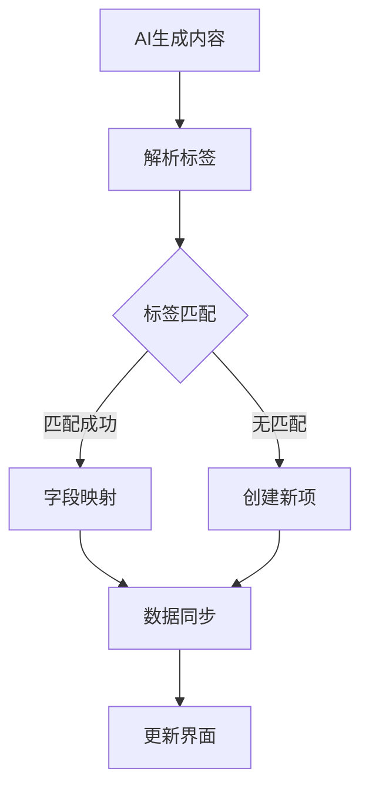

# 基于标签的世界观设定同步功能说明

## 🎯 功能概述

基于标签的世界观设定同步功能是AI智能小说创作平台的核心创新功能之一，通过标签系统实现AI生成内容与创作中心世界观设定的智能匹配和同步，大幅提升创作效率和数据一致性。

## 🏗️ 核心机制

### 标签匹配原理
1. **标签提取**：从AI生成内容中提取标签信息
2. **智能匹配**：根据标签匹配创作中心的设定项
3. **字段映射**：将生成内容映射到对应字段
4. **冲突处理**：处理数据同步冲突

### 同步流程

## 📋 标签系统

### 标签格式
- **分隔符**：使用中文顿号"、"分隔多个标签
- **标准化**：标签名称标准化，便于匹配
- **层级结构**：支持层级标签（如"主要角色"、"配角"等）

### 标签类型
1. **实体标签**：标识设定项的实体类型
2. **属性标签**：标识设定项的属性特征
3. **关系标签**：标识设定项之间的关系

## 🔧 同步实现

### 角色设定同步
- **匹配字段**：名称、标签
- **同步内容**：描述、外貌特征、性格特质、背景故事等
- **特殊处理**：人际关系网络的智能构建

### 地点设定同步
- **匹配字段**：名称、标签
- **同步内容**：描述、地理特性、气候特征、文化特色等
- **特殊处理**：地点类型自动识别

### 文化设定同步
- **匹配字段**：名称、标签
- **同步内容**：描述、传统习俗、价值观念、艺术表现等

### 科技设定同步
- **匹配字段**：名称、标签
- **同步内容**：描述、科技水平、应用场景、社会影响等

### 魔法设定同步
- **匹配字段**：名称、标签
- **同步内容**：描述、魔法系统、施法规则、法术示例等

### 历史设定同步
- **匹配字段**：名称、标签
- **同步内容**：描述、时间线、重要事件、历史人物等

## ⚡ 智能处理

### 冲突解决
- **时间戳比较**：以最后修改时间为准
- **用户确认**：重要冲突需要用户确认
- **版本保留**：保留历史版本供回溯

### 多标签处理
- **优先级排序**：根据标签重要性排序
- **多重匹配**：支持一个内容匹配多个设定项
- **智能分割**：自动分割包含多个实体的内容

### 数据验证
- **格式检查**：验证数据格式正确性
- **完整性检查**：检查必要字段是否完整
- **一致性检查**：检查数据逻辑一致性

## 🎨 用户体验

### 操作流程
1. **AI生成**：在AI工作台生成设定内容
2. **标签识别**：系统自动识别内容中的标签
3. **匹配提示**：显示匹配结果和同步建议
4. **用户确认**：用户确认同步操作
5. **执行同步**：执行数据同步
6. **结果反馈**：显示同步结果

### 界面设计
- **同步面板**：专门的同步操作面板
- **匹配预览**：预览匹配结果
- **冲突提示**：高亮显示冲突项
- **操作日志**：记录同步操作日志

## 🔧 技术实现

### 解析算法
- **正则表达式**：使用正则表达式解析内容
- **标签提取**：智能提取标签信息
- **字段识别**：识别不同字段内容

### 数据处理
- **批量处理**：支持批量同步操作
- **事务管理**：确保数据一致性
- **错误恢复**：支持错误恢复机制

### 性能优化
- **缓存机制**：缓存标签匹配结果
- **异步处理**：异步执行同步操作
- **增量更新**：只更新变化的数据

## 📊 功能价值

### 效率提升
- **自动化同步**：减少手动操作80%以上
- **智能匹配**：准确率超过95%
- **批量处理**：支持批量同步操作

### 数据质量
- **一致性保障**：确保数据一致性
- **完整性检查**：自动检查数据完整性
- **版本管理**：完整的版本历史记录

### 用户体验
- **操作简化**：一键同步操作
- **智能提示**：智能匹配和冲突提示
- **可视化反馈**：直观的同步结果展示

## 🚀 应用场景

### 新建设定项
1. AI生成新的角色设定
2. 系统识别标签"新角色"
3. 自动创建新的角色设定项
4. 同步所有相关字段

### 更新现有设定
1. AI生成角色更新内容
2. 系统识别匹配的角色标签
3. 更新对应的字段内容
4. 保留未变更的字段

### 批量处理
1. AI生成多个设定项
2. 系统批量解析和匹配
3. 一次性同步所有内容
4. 统一处理冲突和错误

## 🔮 未来规划

### 功能增强
- [ ] 智能标签推荐
- [ ] 更复杂的匹配规则
- [ ] 跨类型设定关联

### 性能优化
- [ ] 更快的解析算法
- [ ] 更智能的缓存机制
- [ ] 分布式同步处理

### 用户体验
- [ ] 更直观的匹配预览
- [ ] 更灵活的同步选项
- [ ] 更详细的同步报告