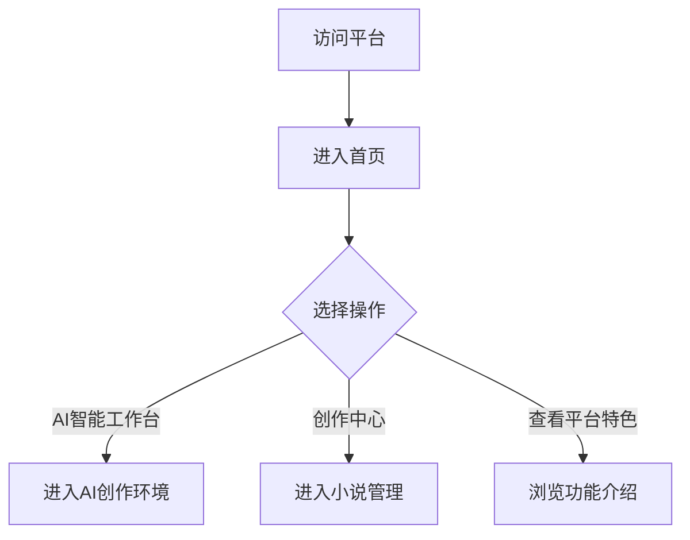
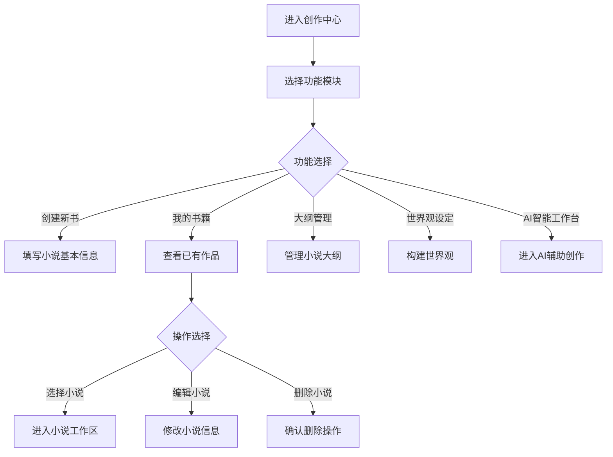
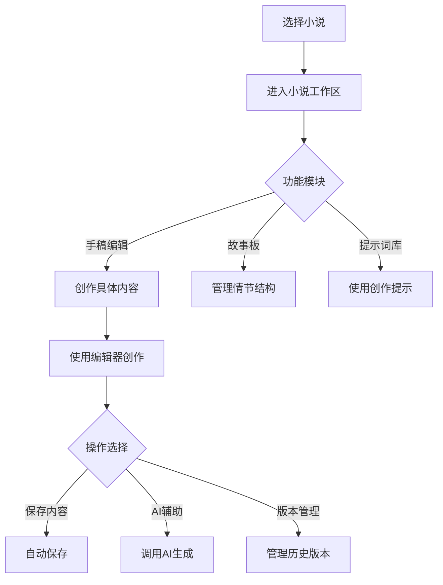
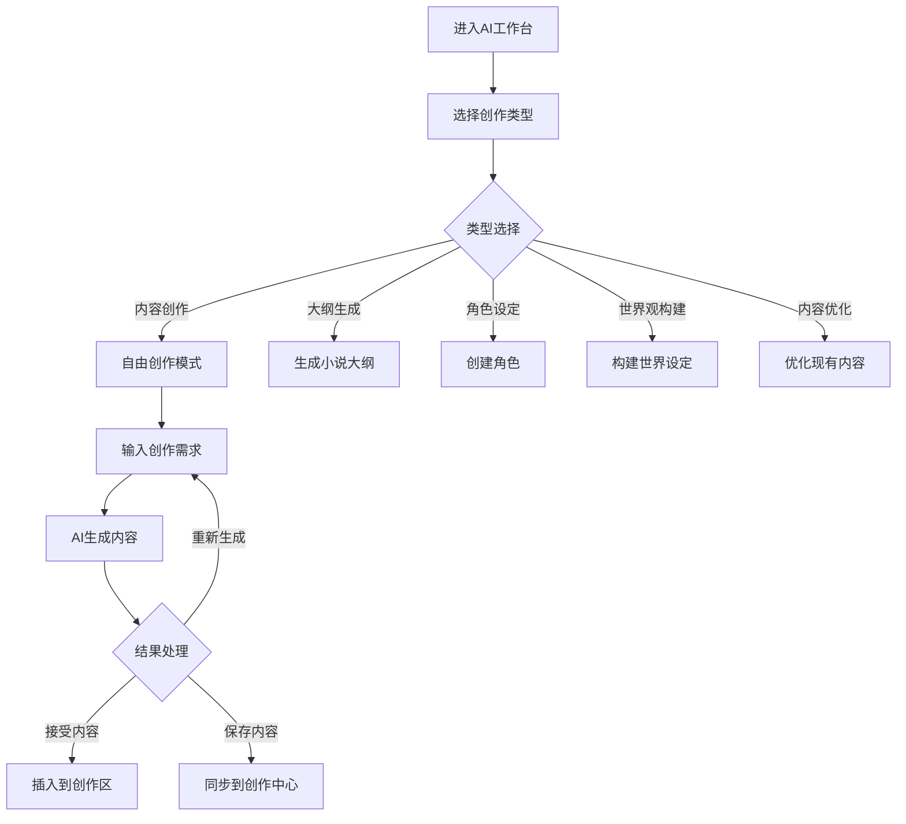

# AI智能小说创作平台用户使用流程

## 1. 概述

AI智能小说创作平台是一个集成了AI辅助创作功能的在线小说写作工具。用户可以通过该平台创建、编辑和管理自己的小说作品，利用AI技术辅助完成大纲设计、角色设定、世界观构建、内容创作等环节。

## 2. 用户角色

- **新手作家**：刚开始写作，需要大量辅助工具和指导
- **业余作家**：有一定写作经验，希望提高创作效率
- **专业作家**：寻求AI辅助以提高创作效率和质量

## 3. 使用流程

### 3.1 初始访问流程



### 3.2 创作中心使用流程



### 3.3 小说创作流程



### 3.4 AI辅助创作流程



## 4. 详细操作步骤

### 4.1 创建新小说

1. 进入创作中心
2. 点击"创建新书"按钮
3. 填写小说基本信息：
   - 标题
   - 类型（如玄幻、都市、仙侠等）
   - 简介
   - 目标字数
4. 点击"创建"完成小说创建

### 4.2 管理小说大纲

1. 在创作中心选择目标小说
2. 点击"大纲管理"进入大纲界面
3. 可选择：
   - 手动创建：点击"新建幕"开始构建大纲结构
   - AI生成：点击"AI生成大纲"，输入需求让AI自动生成
4. 在大纲结构中添加章节和场景
5. 编辑每个节点的详细内容

### 4.3 构建世界观

1. 在创作中心选择目标小说
2. 点击"世界观设定"进入设定界面
3. 可选择不同的设定类型：
   - 角色设定
   - 地点设定
   - 文化设定
   - 科技设定
   - 魔法设定
   - 历史设定
4. 手动添加或使用AI辅助生成相关内容

### 4.4 使用AI工作台

1. 从首页或创作中心进入AI智能工作台
2. 选择目标小说（如需要）
3. 选择创作类型：
   - 内容创作：自由创作模式
   - 大纲生成：生成小说结构
   - 角色设定：创建角色
   - 世界观构建：构建世界设定
   - 内容优化：优化现有内容
4. 输入具体需求描述
5. 选择AI模型配置
6. 点击"开始生成"等待AI创作
7. 处理生成结果：
   - 接受并插入到创作区
   - 重新生成
   - 同步到创作中心

### 4.5 创作具体内容

1. 在小说工作区选择"手稿编辑"
2. 使用富文本编辑器进行创作
3. 可随时调用AI辅助：
   - 选中部分文本请求AI优化
   - 在AI工作台生成内容后插入
4. 系统自动保存创作内容

### 4.6 管理情节结构

1. 在小说工作区选择"故事板"
2. 查看当前小说的情节结构
3. 添加新的幕、章节和场景
4. 编辑已有情节节点的内容
5. 调整情节结构顺序

## 5. 核心功能使用场景

### 5.1 从零开始创作小说

1. 进入平台首页
2. 点击"创作中心"
3. 创建新书并填写基本信息
4. 进入"大纲管理"设计小说结构
   - 可选择手动创建或AI生成
5. 进入"世界观设定"构建世界背景
   - 使用AI辅助生成角色、地点等设定
6. 进入小说工作区开始具体创作
   - 使用"手稿编辑"进行写作
   - 随时调用AI辅助优化内容

### 5.2 继续已有作品创作

1. 进入创作中心
2. 从"我的书籍"中选择目标小说
3. 根据需要进入相应功能模块：
   - 完善大纲结构
   - 补充世界观设定
   - 继续手稿创作
4. 使用AI辅助解决创作瓶颈

### 5.3 使用AI辅助优化内容

1. 进入AI工作台
2. 选择"内容优化"模式
3. 输入需要优化的内容
4. 添加优化要求（如提升感染力、增强逻辑性等）
5. 生成优化结果并应用到作品中

## 6. 用户体验优化建议

### 6.1 新手引导
- 提供详细的操作引导教程
- 在关键功能点添加提示说明
- 提供常见问题解答

### 6.2 个性化设置
- 允许用户自定义界面主题
- 支持个性化创作模板
- 提供创作习惯统计和分析

### 6.3 协作功能
- 支持多人协作创作
- 提供评论和反馈功能
- 实现版本对比和合并

## 7. 注意事项

1. 定期保存创作内容，虽然系统有自动保存功能
2. 合理使用AI辅助功能，保持创作的原创性
3. 注意保护个人创作内容的版权
4. 遵守平台使用规范，不发布违法不良信息

## 8. 附录：功能模块详细介绍

### 8.1 首页功能
- **快速操作入口**：
  - AI智能工作台：进入专业的AI辅助创作环境
  - 创作中心：查看和管理已有作品
- **数据统计**：
  - 总作品数
  - 创作字数
  - 完成度
  - 创作天数
- **平台特色展示**：
  - AI智能辅助
  - 专业编辑器
  - 丰富模板
  - 数据分析

### 8.2 创作中心功能
创作中心是小说管理的核心区域，包含以下功能模块：

#### 8.2.1 我的书籍
- 展示所有已创建的小说作品
- 支持小说的编辑和删除操作
- 可选择小说进入详细创作界面

#### 8.2.2 大纲管理
- 结构化管理小说情节（幕→章节→场景）
- 支持手动创建和AI自动生成
- 可视化展示小说整体结构
- 支持字数统计和进度跟踪

#### 8.2.3 世界观设定
包含多个子模块：
- **角色设定**：创建和管理小说角色
- **地点设定**：构建小说中的地理环境
- **文化设定**：设计小说的文化背景
- **科技设定**：构建小说的科技体系
- **魔法设定**：设计小说的魔法系统
- **历史设定**：编写小说的历史背景

### 8.3 AI工作台功能
AI工作台提供强大的AI辅助创作能力：

#### 8.3.1 创作模式
- **自由创作**：根据用户需求生成内容
- **大纲生成**：自动生成小说结构
- **内容优化**：优化现有文本内容

#### 8.3.2 世界观构建
- 角色生成
- 地点设计
- 文化体系构建
- 科技设定
- 魔法系统
- 历史背景

#### 8.3.3 AI模型配置
- 支持多种AI模型选择
- 可调节生成参数（如温度系数）
- 支持自定义提示词模板

### 8.4 小说工作区功能
选择具体小说后进入的工作区域：

#### 8.4.1 手稿编辑
- 基于Tiptap的富文本编辑器
- 支持实时预览
- 自动保存功能
- 版本历史管理

#### 8.4.2 故事板
- 可视化情节管理
- 支持幕、章节、场景三级结构
- 情节节点编辑功能
- 进度跟踪

#### 8.4.3 提示词库
- 预设创作提示词模板
- 自定义提示词管理
- 提示词分类检索

## 9. 常见问题解答

### 9.1 如何开始创作一部新小说？
1. 进入创作中心
2. 点击"创建新书"
3. 填写小说基本信息
4. 开始构建大纲或直接进入创作

### 9.2 AI生成的内容如何使用？
1. 在AI工作台输入需求
2. 生成内容后可直接插入到编辑器
3. 也可保存到创作中心供后续使用

### 9.3 如何管理多个小说项目？
- 在创作中心的"我的书籍"中查看所有作品
- 可随时切换不同小说进行创作
- 每部小说都有独立的大纲和设定

### 9.4 如何保护我的创作内容？
- 所有内容都存储在本地IndexedDB中
- 支持云端同步备份（需配置Supabase）
- 建议定期导出重要内容

## 10. 技术架构说明

### 10.1 前端技术栈
- React + TypeScript
- Ant Design组件库
- Zustand状态管理
- Tiptap富文本编辑器

### 10.2 数据存储
- 本地存储：IndexedDB
- 云端同步：Supabase（可选）
- 混合存储架构，支持离线使用

### 10.3 AI集成
- 支持多种大语言模型（DeepSeek、OpenAI等）
- 本地模型支持（Ollama）
- 可扩展的模型配置系统

## 11. 完整用户旅程图

``mermaid
graph TD
    A[用户访问平台] --> B[进入首页]
    B --> C{选择入口}
    C -->|AI工作台| D[AI辅助创作]
    C -->|创作中心| E[小说管理]
    
    D --> D1[选择创作类型]
    D1 --> D2{类型选择}
    D2 -->|内容创作| D3[输入需求生成内容]
    D2 -->|大纲生成| D4[生成小说结构]
    D2 -->|角色设定| D5[创建角色]
    D2 -->|世界观构建| D6[构建设定]
    D2 -->|内容优化| D7[优化文本]
    
    D3 --> D8[处理生成结果]
    D8 -->|接受内容| D9[插入到创作区]
    D8 -->|重新生成| D3
    D8 -->|同步中心| D10[保存到创作中心]
    
    E --> E1[创建新书]
    E1 --> E2[填写基本信息]
    E2 --> E3[完成创建]
    
    E --> E4{操作选择}
    E4 -->|选择小说| E5[进入小说工作区]
    E4 -->|编辑信息| E6[修改小说信息]
    E4 -->|删除小说| E7[确认删除]
    
    E5 --> E8{功能模块}
    E8 -->|手稿编辑| E9[内容创作]
    E8 -->|故事板| E10[情节管理]
    E8 -->|提示词库| E11[使用提示词]
    
    E9 --> E12[使用编辑器]
    E12 --> E13{操作选择}
    E13 -->|保存内容| E14[自动保存]
    E13 -->|AI辅助| E15[调用AI生成]
    E13 -->|版本管理| E16[管理历史版本]
    
    E10 --> E17[查看情节结构]
    E17 --> E18[添加情节节点]
    E17 --> E19[编辑节点内容]
    
    E3 --> E5
    D10 --> E5
```

## 12. 总结

AI智能小说创作平台为用户提供了一套完整的创作解决方案，从构思、大纲设计到具体写作，再到世界观构建，都有相应的工具和AI辅助功能支持。用户可以根据自己的需求和习惯选择合适的使用路径，既可以完全依赖AI辅助，也可以在传统写作基础上选择性使用AI功能。

平台的核心优势在于：
1. **AI深度集成**：在各个环节都提供了AI辅助功能
2. **结构化管理**：通过大纲和故事板帮助用户理清创作思路
3. **世界观构建**：专门的模块帮助用户构建完整的世界观
4. **灵活使用**：用户可以根据需要选择功能模块，不必按固定流程使用
5. **数据安全**：本地存储为主，云端同步为辅，保障用户数据安全

通过合理使用平台提供的各项功能，用户可以显著提高创作效率，解决创作瓶颈，创作出更加丰富和完整的小说作品。